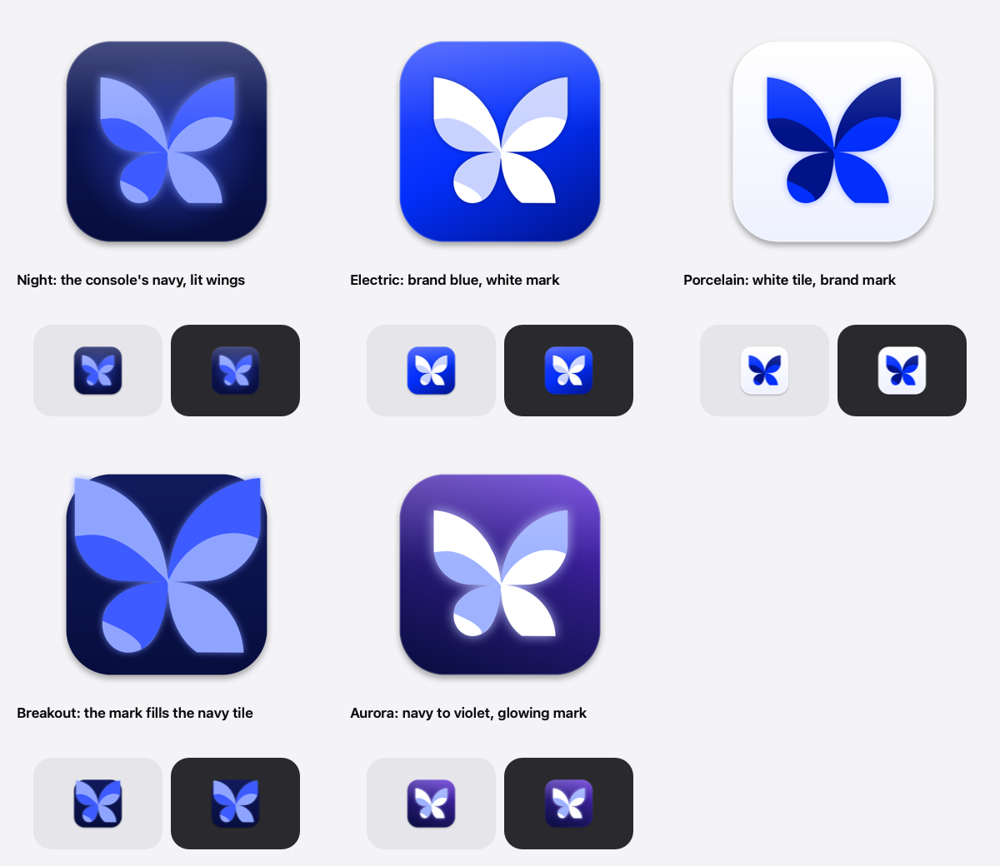
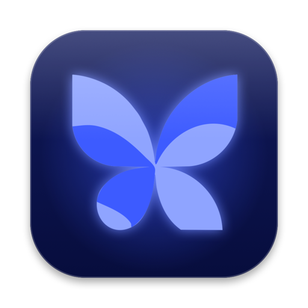
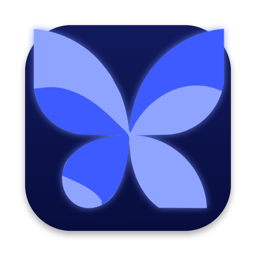
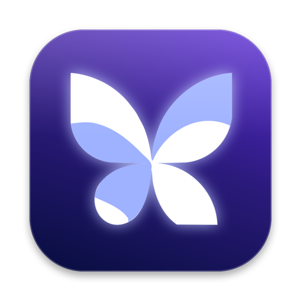

# App icon concepts

On macOS 26 the bare butterfly that `hack/make-icon.sh` ships is drawn inside
a grey rounded square, because the icon has no tile of its own. Each concept
here gives the mark its own tile. The mark's paths are the ones in
`Resources/k3sm-mark.svg`; only the wing colours change.

Nothing here changes the shipped icon. To adopt one:

```sh
hack/icon-concepts.sh --pick <concept> Resources/AppIcon.icns
```

To re-render this folder after the mark or a concept changes:

```sh
hack/icon-concepts.sh docs/icon-concepts
```



| Concept | | Tile | Wings |
|---|---|---|---|
| `night` |  | the console's navy, `#111a5c` to `#070d3d`, with a blue glow | `#8fa4ff` / `#3d5bff`, glowing |
| `electric` |  | brand blue, `#2d48fe` to `#022ffb` to `#011389` | white / `#c9d2ff` |
| `porcelain` |  | white to `#eef1ff` | the brand's `#022ffb` / `#011389` |
| `breakout` |  | the console's navy | `#8fa4ff` / `#3d5bff`, the mark at 86% so it meets the tile's edges |
| `aurora` |  | navy to violet, `#070d3d` to `#5b2bd6` | white / `#9fb2ff`, glowing |

The tile follows Apple's macOS icon grid (an 824-point rounded square on the
1024 canvas). These are flat renders. Icon Composer can take the chosen
concept's tile and wings as separate layers, which gives the system's glass
treatment and the dark and tinted variants.
